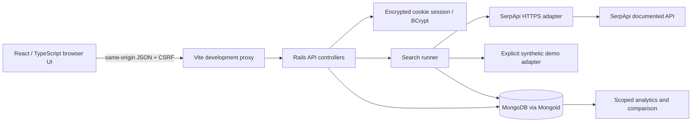

# SearchScope implementation plan

## Goal and evidence standard

Build a working personal portfolio application for Eldar Smagulov's SerpApi
Junior Fullstack Engineer application. Features, tests, deployments, and
candidate skills must be described only at the level actually demonstrated.
Generated code does not establish the candidate's independent proficiency.
No employment, credentials, usage metrics, or GitHub activity will be invented.

## Discovery

The initial repository contained only a README and MIT license. The implemented
application now includes the six-page client and authenticated Rails API,
MongoDB persistence, provider adapters, and Docker tooling. Final local
initial validation executed 79 backend examples and 47 frontend tests, plus browser,
lint, build, and security checks. Detailed evidence and outstanding checks are
in [docs/validation-report.md](docs/validation-report.md). Source publication
and observed GitHub CI results are recorded in
[docs/publication-report.md](docs/publication-report.md). Paid SerpApi requests
and external deployment have not been performed.

The free-hosting preparation adds an opt-in combined Rails/React production
image, a Free Render Blueprint, strict hostname handling, and API Origin-check
regressions. Latest local checks executed 103 backend examples and 47 frontend
tests; see [docs/hosting-validation.md](docs/hosting-validation.md). Hosting
account access and current no-charge terms are still required for a public
demo. Existing source history, features, and separate Docker images are retained.

Verified environment: Linux x86_64, Docker 28.4.0, Compose 2.40.3, Node.js
24.19.0, Ruby 3.4.11 and Rails 8.1.4 inside Docker. Rails 8.1 and Mongoid 9.1.1
have booted together and passed the foundation checks. Dependency changes
will be resolved against Ruby/Rails constraints and revalidated, then locked.
The cloud's trusted CA must be supplied to containers behind its HTTPS proxy;
TLS and package verification must remain enabled.

## Architecture

Use a single repository with `backend/`, `frontend/`, `docs/`, `application/`,
Docker configuration, and GitHub Actions. Rails provides routing, validation,
session/CSRF protection, and testing conventions. Mongoid maps the search
documents to MongoDB and supports indexes and aggregation. Provider adapters
normalize heterogeneous results without persisting raw provider responses.

## Milestones

1. **Core API:** migrate backend tests to RSpec; add validated Mongoid user and
   search models, BCrypt authentication, encrypted cookie sessions, CSRF, and
   user-scoped data access. Implement search execution, bounded provider I/O,
   retained errors, history filtering/pagination/detail/deletion, comparison,
   analytics, monitoring, and readiness checks.
2. **Product UI:** implement login/registration and functional Dashboard,
   Explorer, Comparison, History, Monitoring, and Settings pages. Cover loading,
   empty, error, retry, and keyboard-accessible states. Every control must work.
   Demo responses must be identified as synthetic in both stored data and UI.
3. **QA/infrastructure:** add Ruby/TypeScript linting, formatting and practical
   static checks; run RSpec with MongoDB, frontend tests, builds, and local HTTP
   smoke tests. Preserve frozen installs, persistent volumes, and realistic CI.
4. **Documentation:** document environment variables, API/OpenAPI, architecture,
   security, retention, rate limits, costs, tradeoffs, and honest limitations.
   Capture screenshots only from the running application if tooling permits.
5. **Career materials:** inspect accessible existing repositories without
   modifying them; draft profile README and pin recommendations; produce an
   ATS-friendly PDF/DOCX CV, cover email, and interview exercises from evidence.
   Ask for missing contact details and distinguish personal projects from work.
6. **Release preparation:** inspect tracked files for secrets, record exact
   validation outcomes, prepare meaningful local commits with confirmed author
   identity, and save reusable environment instructions. Source publication and
   free deployment are now authorized. Charges, application sending, and paid
   provider calls require separate approval.

## Security and data decisions

- Keep `SERPAPI_API_KEY` server-side and out of source, logs, Vite, and API
  responses. Inspect existing bindings before requesting secure configuration.
- Use BCrypt and Rails session encryption/CSRF libraries. Invalidate persisted
  user session versions on logout; use HttpOnly, SameSite cookies and Secure
  cookies in production. Production requires a real secret key and HTTPS.
- Require authentication and owner scoping for every stored-data endpoint.
  Validate query length, engine, pagination, IDs, and filters. Render result
  text safely and permit only HTTP(S) result URLs; never fetch result URLs.
- Use a fixed SerpApi endpoint, connection/read timeouts, and bounded retries
  only for failures known to precede connection. Do not retry timeouts or 429s
  automatically or bypass provider restrictions. Ordinary tests cannot call a
  paid provider. A live integration check requires explicit approval and a key.
- Store only normalized search fields and allowlisted metadata, with a default
  30-day TTL. Hide expired records immediately even before MongoDB TTL cleanup.
- Limit authentication/search traffic. Document single-process limiter limits
  and production requirements for shared rate-limit state, authenticated
  MongoDB, TLS, backups, and persistent infrastructure.

## Test strategy

RSpec request/model/service tests cover valid/invalid searches, CSRF,
authentication, logout, tenant isolation, persistence, pagination/deletion,
comparison, analytics, and provider failures. WebMock fixtures exercise the
documented external contract without spending credits. Database cleanup is
restricted to a confirmed test database.

Frontend tests cover forms, requests, loading/errors, result rendering,
comparison and auth behavior. Run TypeScript checks and production builds.
Run both linters, formatting checks, and practical Ruby/dependency security
checks. Verify successful behavior through real local HTTP requests and record
commands and exit statuses. Keep remote CI, live SerpApi, deployment, skipped
checks, and unavailable tooling distinct from local passes.

## Definition of done

- A new local user can register, log in, run explicitly labelled demo searches,
  view their persisted history, compare results, inspect actual analytics, and
  log out. Another user's data remains inaccessible.
- The real provider adapter is implemented and deterministically tested;
  live provider verification is separately reported pending credentials/approval.
- Docker setup and startup are exercised, lockfiles retained, tests/lint/build
  completed, and failures corrected or precisely explained.
- Documentation describes the implemented behavior and limitations, and career
  artifacts contain no unsupported claims or invented contact information.
- Publication/deployment/email remain separate approval-gated steps. Current
  local validation never implies those external steps succeeded.
