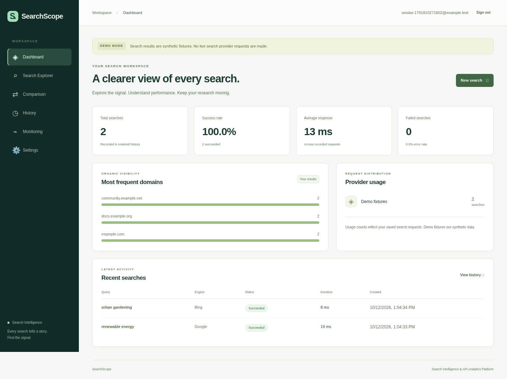
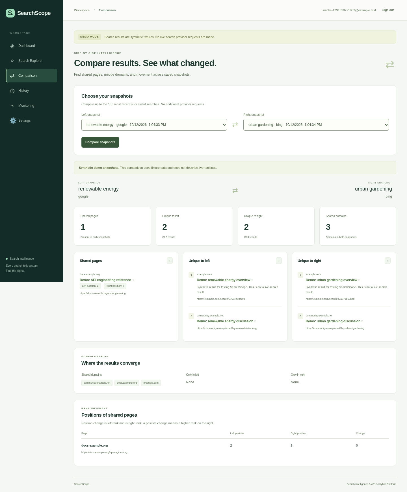

# SearchScope

[](https://github.com/rokerblym/searchscope/actions/workflows/ci.yml)

**Search Intelligence & API Analytics Platform**

SearchScope is a personal engineering portfolio project for exploring search
results through SerpApi, comparing saved snapshots, and understanding the API
requests an account has made. It combines a Rails API, a React/TypeScript client,
and MongoDB persistence. It is designed to make API integration, error handling,
testing, and engineering tradeoffs visible to reviewers.

The application implements its core workflows. Live SerpApi access has not been
verified with a paid request, and no public deployment is claimed. Demo mode uses
explicitly labelled synthetic results. See the verification notes below before
interpreting the project as a production service.

## Implemented workflows

- **Search Explorer:** validated Google/Bing queries, server-side provider calls,
  normalized titles/URLs/snippets/positions, execution duration, safe metadata,
  and persisted failure states.
- **Search Comparison:** compare two saved successful searches by URL, domain,
  positions, overlap, and unique results, without additional provider requests.
- **Dashboard:** account-specific search volume, success/error rates, measured
  durations, frequent domains, provider usage, and recent searches.
- **Search History:** newest-first pagination, status/engine/exact normalized
  query filters, details, and confirmed snapshot deletion.
- **API Monitoring:** real application/database status, provider configuration
  presence, retention settings, and recent errors. Configuration presence is
  not a test of provider credentials or quota.
- **Settings:** inspect server-managed configuration and sign out. This screen
  does not expose keys or pretend to modify runtime environment variables.
- **Authentication:** registration, login, logout, bcrypt password hashing,
  encrypted cookie sessions, CSRF protection, and account-isolated data access.

Loading, error, empty, and synthetic-data states are explicit. Query comparisons
are descriptive snapshots; they do not establish statistical significance or
comprehensive coverage of a search engine.

## Technology and structure

| Component | Technology |
| --- | --- |
| API | Ruby 3.4.11, Rails 8.1, Mongoid 9.1, Puma |
| Client | React 19, TypeScript 6, Vite, Node.js 24.19.0 |
| Persistence | MongoDB 8.0 with account/query indexes and TTL retention |
| Tests | RSpec + WebMock; Vitest + React Testing Library |
| Quality | RuboCop, Brakeman, bundler-audit, ESLint, Prettier |
| Packaging | Docker, Docker Compose, GitHub Actions |

Exact dependencies are recorded in `backend/Gemfile.lock` and
`frontend/package-lock.json`. TypeScript 6 was selected to satisfy the installed
linting toolchain's peer compatibility rather than selecting a newer major
without validation.

```text
backend/                 Rails API, models, provider adapters, RSpec tests
frontend/                React client, typed API client, behavioral tests
Dockerfile               Combined Rails + built React production image
render.yaml              Free-only hosting candidate; Atlas configured separately
bin/setup                Frozen dependency installation through Docker builds
bin/start                Service startup with optional cloud proxy trust
bin/compose              Compose wrapper for build and runtime trust
bin/test                 Container-based backend/frontend tests and build
docker-compose.yml       Local development services and persistent database
.github/workflows/ci.yml  Automated checks when run on GitHub
docs/                    OpenAPI, architecture, security, deployment, portfolio
application/             CV, email draft, and interview preparation
IMPLEMENTATION_PLAN.md   Milestones, test strategy, and definition of done
```

The architecture and its tradeoffs are explained in
[docs/architecture.md](docs/architecture.md). Rails supplies established request,
validation, session, and CSRF mechanisms; Mongoid maps the document-shaped result
snapshots into MongoDB. The choice also gives this project a concrete overlap
with SerpApi's published stack. MongoDB is not required for every analytics
application: the schema and aggregation tradeoffs are documented.

## Run locally with Docker

**macOS Terminal:** install Docker Desktop with Compose v2, start Docker Desktop,
then open a terminal in your existing SearchScope checkout. The cloud checkout
already exists at `/workspace/searchscope`; use that checkout in Codex. Avoid
creating another worktree for ordinary development in the isolated cloud task.

For a first checkout on your Mac, run in **macOS Terminal**:

```sh
git clone https://github.com/rokerblym/searchscope.git
cd searchscope
```

Then configure the local environment from that checkout:

```sh
cd /path/to/searchscope
test -f .env || cp .env.example .env
```

**VS Code:** open `.env` and set `SEARCH_PROVIDER=demo`. Keep
`SERPAPI_API_KEY` empty for this first run. The ignored file is local only.

**macOS Terminal:** build and start the services:

```sh
./bin/setup
SEARCH_PROVIDER=demo ./bin/start
curl --fail http://127.0.0.1:3000/api/v1/health
```

**Browser:** open <http://localhost:5173>, register a local test account, and run
queries such as `Ruby API engineering` and `Rails API testing`. Use a password
of at least 10 characters and no more than 72 UTF-8 bytes. Compare the saved
snapshots, inspect analytics/history, and delete a snapshot to observe the
metrics change. The banner and provider fields identify synthetic demo data.

Services bind to the local machine: frontend `5173`, backend `3000`, MongoDB
`27017`. Vite proxies `/api` while preserving the browser's Host for Rails CSRF
origin checks. MongoDB data survives ordinary container restarts in a named
volume. The development database has no authentication and must remain local.

```sh
# macOS Terminal: inspect readiness or stop without deleting database data.
./bin/compose exec backend bin/check-mongodb
./bin/compose logs --tail=100 backend
./bin/compose down
```

`down` preserves the named data volume. Do not add `-v` unless you intentionally
want to delete local databases. Database indexes are created at backend startup.

The cloud environment may need
`DOCKER_CONFIG=/workspace/.cache/searchscope-docker`. `bin/compose`, used by
setup/start/test, supplies an existing trusted
`SSL_CERT_FILE` or `NODE_EXTRA_CA_CERTS` as an optional BuildKit secret and a
read-only runtime trust bundle, with the cloud proxy host entry when needed.
Temporary Compose overrides are removed after the invocation. TLS verification
stays enabled; the trust bundle and API credentials are not baked into images.
On macOS without these cloud variables the same wrappers use ordinary Compose.

## Environment configuration and live SerpApi

| Variable | Meaning |
| --- | --- |
| `SEARCH_PROVIDER` | `demo` for synthetic local examples; `serpapi` for real provider calls |
| `SERPAPI_API_KEY` | Backend-only key; required for `serpapi` |
| `SEARCH_RETENTION_DAYS` | 1–365 days; defaults to 30 |
| `MONGODB_URI` | Database URI; Compose supplies separate development/test databases; required in production |
| `SECRET_KEY_BASE` | Required production Rails secret, supplied at runtime |
| `ALLOWED_HOSTS` | Production comma-separated approved hostnames; combined Render hosting can use its exact platform hostname when absent |
| `SERPAPI_USER_DAILY_LIMIT` | Maximum reserved attempts per account per UTC day; default 20 |
| `SERPAPI_GLOBAL_DAILY_LIMIT` | Maximum reserved attempts across accounts per UTC day; default 200 |
| `API_PROXY_TARGET` | Development Vite proxy target; Compose uses `http://backend:3000` |

**VS Code or secure cloud environment settings:** store a SerpApi key in an
ignored `.env` or a secret binding. Never paste it into source, the frontend,
`VITE_` variables, build arguments, screenshots, application materials, or chat.
Then set `SEARCH_PROVIDER=serpapi` and restart the backend with
`./bin/start --force-recreate backend` in macOS Terminal or the Codex terminal.

**Browser:** submit a real search only after explicitly authorizing provider
credit usage. Each submission may be billed. This repository does not run a live
provider request as part of installation, tests, health checks, or CI. Missing
credentials return a safe configuration error; the UI does not fall back to fake
live results.

The provider adapter uses a fixed HTTPS destination, 5-second connect/write and
20-second read timeouts, a 30-second deadline covering connection/retry/response
download, a streamed 2 MiB response cap, and safe error codes. It retries once
only for DNS or
connection-refused failures before connection establishment. It does not retry
HTTP failures, rate limits, disconnected requests, or timeouts that could have
already consumed credits. MongoDB atomic daily counters reserve each live
attempt before provider I/O, including failures: 20 per account and 200 globally
by default. Limits accept 1–10,000; demo mode bypasses them. Reservations are
conservative and never refunded, even when no provider call occurs. Exhaustion
returns `429 provider_budget_exceeded` and persists the failed snapshot. These
are spending safeguards, not a SerpApi billing ledger. See
[security notes](docs/security.md).

## Tests and quality checks

**macOS Terminal:** run the container-based test command from the repository root:

```sh
./bin/test
```

Backend tests use `searchscope_test` and real MongoDB for persistence/access
control. WebMock blocks external network requests; provider behavior is tested
with synthetic responses, never a paid SerpApi call. Frontend tests cover typed
API behavior, authentication/search states, comparison, history, and monitoring.
The production frontend build includes a strict TypeScript check.

Additional checks from the repository root:

```sh
./bin/compose run --rm --no-deps backend bundle exec rubocop
./bin/compose run --rm --no-deps backend bundle exec brakeman --no-pager --exit-on-warn --exit-on-error
./bin/compose run --rm --no-deps backend bundle exec bundle-audit check --update
./bin/compose run --rm --no-deps frontend npm run lint
./bin/compose run --rm --no-deps frontend npm run format:check
```

The vulnerability advisory update needs network access; an unavailable advisory
source is a limitation of that check, not proof that dependencies are safe.

Recorded commands, observed results, and remaining verification limits are in
[docs/validation-report.md](docs/validation-report.md). The latest
[hosting checks](docs/hosting-validation.md) cover 103 passing RSpec examples,
47 passing frontend tests, and a local HTTPS browser run of the combined
production image. This is local validation; a public deployment remains pending.

GitHub Actions installs frozen dependencies and runs RSpec, MongoDB checks,
RuboCop, Brakeman, dependency audit, frontend tests/lint/format checks, and the
frontend build, plus separate and combined production image builds without publishing.
Publication triggered GitHub Actions. See the [Actions page](https://github.com/rokerblym/searchscope/actions)
for current workflow status and the [publication report](docs/publication-report.md)
for recorded verification. Local test counts come from executed checks, not
from CI YAML.

For host development in **macOS Terminal**, use Ruby 3.4.11 with Bundler and
Node.js 24. Start MongoDB from the repository root with `./bin/start mongodb`,
then run `BUNDLE_FROZEN=true bundle install` and `bin/server` in `backend/`;
run `npm ci` and `npm run dev` in `frontend/`. `bin/server` creates the required
unique and TTL indexes before starting Rails. Keep the Rails and
frontend proxy on matching local origins. The cloud host does not require a
host Ruby installation because backend commands run in containers.

## API documentation

The complete contract is [docs/openapi.yaml](docs/openapi.yaml). Start with
`GET /api/v1/session`, keep its cookie, and send `X-CSRF-Token` for mutations.
Login and registration rotate the session/token. Reads require authentication
except liveness/session bootstrap.

| Method | Route | Purpose |
| --- | --- | --- |
| GET | `/api/v1/health` | Process liveness |
| GET | `/api/v1/session` | Session/CSRF bootstrap |
| POST | `/api/v1/auth/register`, `/api/v1/auth/login` | Account creation/login |
| DELETE | `/api/v1/auth/logout` | Session invalidation/logout |
| POST, GET | `/api/v1/searches` | Create search/list history |
| GET, DELETE | `/api/v1/searches/:id` | Snapshot details/deletion |
| POST | `/api/v1/comparisons` | Compare two successful snapshot IDs |
| GET | `/api/v1/analytics` | Account metrics |
| GET | `/api/v1/monitoring` | Database ping and safe configuration |

A successful result can contain `snippet: null` or `position: null`; missing
provider totals remain null. Errors use `{ "error": { "code": "...", "message":
"..." } }`; failed searches additionally include the saved `search`. Health is
liveness only. Monitoring reports database readiness and configuration presence,
not live provider health.

## Production preparation and limitations

For a complete public portfolio demo, the root Dockerfile serves React and
the Rails API from one origin, with MongoDB hosted separately. The
[free-hosting investigation and setup guide](docs/free-deployment.md) includes
the conditional Render/Atlas path, current source-backed limits, account setup
steps, and a verification checklist. **No live application URL has been
verified yet:** hosting accounts, secure database configuration, and confirmation
of the host's current no-charge terms are required. The repository URL is not
a running application URL.

`render.yaml` selects `plan: free` and `SEARCH_PROVIDER=demo`; it includes no
paid disk, worker, database, or API key. Its provider-side validation and
deployment have not run. Stop if the hosting dashboard requires payment or an
upgrade. Demo searches remain labelled synthetic; the real SerpApi adapter and
all existing application features are preserved.

Separate production Dockerfiles run Rails without development/test gems and
serve built static assets with unprivileged Nginx. Rails enforces TLS and secure
cookies in production, and requires an explicit hostname allowlist. These
images require runtime secrets, an authenticated
MongoDB endpoint, and a trusted TLS proxy; the development Compose file is not
a public deployment configuration. The optional AWS ECS/MongoDB Atlas runbook
is in [docs/deployment.md](docs/deployment.md). No AWS deployment is claimed.

Current limitations include synchronous provider requests, no idempotency key,
per-process per-minute rate limits, offset pagination,
no email verification/password reset/account deletion, no background worker, and
no backups or production monitoring configured by this repository. Query records
expire after 30 days by default; MongoDB TTL cleanup is asynchronous, and API
queries additionally exclude expired records. Account email and password hash
persist until a separately implemented account lifecycle removes them.

Search creation is limited per authenticated account; login/registration are
limited per proxy-aware client IP. Counts are held in process memory, so
replicas require shared or edge rate limits and a reviewed trusted-proxy policy.
Daily provider-attempt budgets are shared through atomic MongoDB counters.

Future work should prioritize distributed request limits, measured budget tuning,
account lifecycle, larger-data performance tests, and an approved deployment.

## Captured application

These are actual Chromium screenshots of the running local application in
explicit demo mode. Search results are synthetic; dashboard metrics come from
the smoke account's persisted demo requests. They do not demonstrate live
provider performance or a production deployment.





See the [eight captures and browser smoke instructions](docs/screenshots/README.md)
for all pages and the mobile viewport.

## Portfolio and release review

[Application materials](application/README.md) include a one-page CV in PDF and
DOCX, an unsent cover email, interview exercises, and a proposed profile README.
The [existing repository review](docs/portfolio-review.md) records read-only
findings and conditional pin recommendations. Generated project code does not
establish the candidate's independent proficiency.

The source is published at [rokerblym/searchscope](https://github.com/rokerblym/searchscope).
The [publication report](docs/publication-report.md) records public access,
file verification, preserved history, and observed CI status. Free deployment is
authorized but requires hosting access and verified no-charge terms. Charges
and application submission require separate approval. Application materials remain
review drafts; no application email has been sent. Follow the
[release checklist](docs/release-checklist.md) before deploying or submitting.

## License

[MIT](LICENSE).
