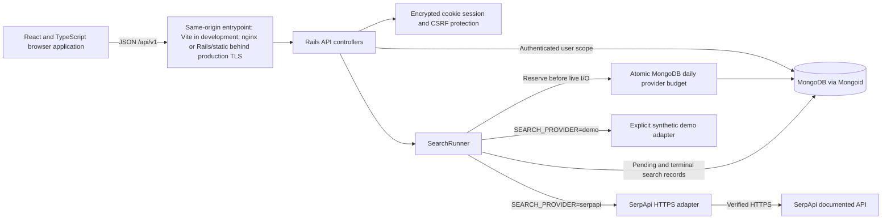

# Architecture

SearchScope is a personal portfolio application for exploring search snapshots,
comparing their results, and inspecting the requests made by the application.
It uses a Rails JSON API, a React browser application, and MongoDB. A live search
uses SerpApi's documented API; an explicitly selected demo adapter returns
synthetic fixtures without an external request.

## Components and versions

| Component | Repository choice | Purpose |
| --- | --- | --- |
| Ruby | 3.4.11 | Backend runtime |
| Rails | 8.1.4 | API routing, sessions, CSRF protection, controllers |
| Mongoid | 9.1.1 | Rails-compatible MongoDB document mapping |
| MongoDB | 8.0 Docker image | Persistence, indexes, aggregation, TTL cleanup |
| Node.js | 24.19.0 Docker image | Frontend development and build tooling |
| React | 19.3.0 | Browser interface |
| TypeScript | 6.0.3 | Frontend type checking |
| RSpec / WebMock | Locked in `backend/Gemfile.lock` | Backend tests without paid provider calls |
| Vitest / Testing Library | Locked in `frontend/package-lock.json` | Frontend request and component tests |

The dependency lockfiles define the exact resolved dependency graph. The MongoDB
image currently follows the maintained 8.0 series rather than a fixed digest.
For a release, record and pin tested image digests before deployment.



The production route in the diagram is deployment preparation, not evidence of
a live deployment. See [deployment.md](deployment.md) for its requirements.

## Production frontend delivery options

The separate-container option uses `frontend/Dockerfile.production` to serve
React assets from nginx and proxy `/api/` to the Rails service built with
`backend/Dockerfile.production`. Both application services remain private
behind a trusted TLS gateway. nginx supplies the frontend/API security headers,
cache policy, and 16 KiB request-body limit. This topology remains supported.

The root [Dockerfile](../Dockerfile) provides a combined option: Node builds
React once, and an unprivileged Rails/Puma runtime serves the resulting files
from `public/` alongside the existing API. It runs no nginx process and stores
no database inside the application container. Both options require a separate,
authenticated MongoDB service with TLS. The browser uses the same origin for
assets, sessions, and API requests, so no cross-origin cookie or CORS setup is
introduced.

`SERVE_FRONTEND=true` enables an outer Rack policy around static files and API
responses, plus Puma's 16 KiB upload limit. It retains the security headers of
the nginx option: same-origin scripts/connections, denied framing, content-type
protection, no-referrer policy, and restricted browser permissions. Inline
styles remain allowed for calculated dashboard bar widths. API responses use
`no-store`; HTML, unversioned files, and missing assets use `no-cache`.
Successful fingerprinted non-HTML assets under `/assets/` use one-year immutable
caching. The flag is opt-in; existing API-only operation does not gain this
hosting policy unless it is explicitly enabled.

The Rack layer reads at most 16 KiB plus one byte before Rails parameter
parsing and rejects oversized bodies even without a trustworthy length header.
Puma also applies its server-level limit before the Rack application. Its
early HTTP errors have Puma's response format and do not pass through the Rack
JSON/header policy. See [security.md](security.md) for these boundaries.

Navigation uses URL hashes, so serving `/`, `index.html`, and actual built
files is sufficient. There is no SPA catch-all that turns missing API or asset
paths into the frontend document. Unknown `/api` paths instead reach a final,
read-only JSON `404` handler; valid API routes remain ahead of that fallback.

Production normally requires explicit `ALLOWED_HOSTS`. When it is absent and
frontend hosting is enabled, a validated `RENDER_EXTERNAL_HOSTNAME` supplied
by Render can provide one exact allowed hostname. Explicit configuration takes
precedence, and an empty explicit list or missing/invalid fallback fails startup.
`RAILS_ASSUME_SSL=true` is a separate opt-in for a trusted TLS edge with private
backend HTTP; it does not add encryption to a directly exposed HTTP service.
The [Render blueprint](../render.yaml) describes this combined option with demo
searches and runtime secret bindings. It neither provisions MongoDB nor proves
that a public service, live provider call, or remote deployment exists.

## Repository structure

```text
backend/
  app/controllers/       HTTP validation, authentication, owned record access
  app/models/            User, SearchRequest, and SearchBudget Mongoid documents
  app/services/          Provider adapters, search execution, comparison, analytics
  app/serializers/       Explicit search response representation
  config/                Routes, MongoDB, sessions, logging, rate limits
  lib/search_scope/      Opt-in frontend HTTP policy and production host validation
  spec/                  RSpec requests, models, services, provider fixtures
frontend/
  src/api.ts             Same-origin API client and in-memory CSRF token
  src/App.tsx            Session bootstrap, account access, navigation
  src/pages/             Dashboard, Explorer, Comparison, History, Monitoring, Settings
docs/                    Architecture, security, operation, API, validation evidence
application/             Honest application materials and interview preparation
bin/                     Reproducible local setup and verification helpers
.github/workflows/       Proposed GitHub Actions checks
```

## Authentication and isolation

`GET /api/v1/session` bootstraps the session and returns a CSRF token. The browser
holds that token in memory and sends it as `X-CSRF-Token` for every mutation,
including registration and login. The browser manages the encrypted Rails
session cookie; JavaScript cannot read the HttpOnly cookie.
API controllers explicitly enable Rails' Origin check: a foreign Origin is
rejected with `403` even when the session cookie and CSRF token are valid.
Same-origin requests with valid tokens continue to work; requests without an
Origin header still need a valid token for a defined state-changing endpoint.

Registration and login reset the session before storing the user ID and the
user's `auth_version`. A session expires after 24 hours. Logout increments the
persisted version and clears the cookie session, invalidating every existing
session for that account. This deliberately provides account-wide logout.

Every stored-data endpoint starts from the authenticated user's association
and adds `expires_at > now`. Detail, deletion, comparison, history, and analytics
therefore use the same owner and retention boundaries. A foreign or expired
search ID returns the same not-found response as an absent ID. There is no
administrator or shared-workspace access model.

## Search execution

1. The controller accepts a string query containing 1–200 characters after
   trimming, and an engine from the `google` / `bing` allowlist.
2. `SearchRunner` inserts a `pending` search belonging to the current user and
   assigns a retention expiry.
3. Live mode atomically reserves per-account and global UTC-day budgets in
   MongoDB before provider I/O. Exhaustion records a failed snapshot with `429`.
   The live adapter contacts only `https://serpapi.com/search.json`; demo mode
   skips budgets and makes no network calls.
4. The result normalizer accepts up to 100 usable organic results, permits only
   HTTP(S) URLs without embedded credentials, and preserves optional snippets
   and positive integer positions. It derives a normalized domain from the URL.
5. The runner saves a `succeeded` or `failed` record with duration and safe error
   information. The response is `201` on success, or a meaningful error status
   with the saved failed search when the provider cannot complete the request.

Duration uses a monotonic clock. It includes the initial database insertion and
provider/normalization work, and excludes the final database save and browser
rendering. It is an application measurement, not a provider performance SLA.

The adapter has 5-second connection/write timeouts and a 20-second read timeout.
A 30-second deadline bounds connection/retry/response download, and response
chunks are capped at 2 MiB before accumulating a larger body. JSON parsing and
database operations are outside that provider transport deadline.
It disables Net::HTTP's automatic retries. It attempts one additional request
only on DNS resolution or connection-refused failures; timeouts, dropped
connections, HTTP errors, and rate limits are not automatically retried because
the provider might already have billed the request.

Provider metadata is allowlisted to a provider search ID and a nonnegative total
result estimate. Raw provider bodies, credentials, unrelated search parameters,
and provider exception text are not persisted or returned. Demo metadata is
marked `demo: true`, and the interface labels synthetic results.

## Data model and retention

| Document | Stored fields | Indexes |
| --- | --- | --- |
| `User` | Normalized email, bcrypt password digest, session version, timestamps | Unique email |
| `SearchRequest` | Owner, query and normalized query, engine, provider, status, duration, normalized results, allowlisted metadata, safe error, expiry, timestamps | Owner/date/ID; owner/status/engine/normalized query; expiry TTL |
| `SearchBudget` | Opaque user/global UTC-day key, reserved count, expiry | Unique budget key; expiry TTL |

Live-mode budgets default to 20 reserved attempts per account per UTC day and
200 globally. `SERPAPI_USER_DAILY_LIMIT` / `SERPAPI_GLOBAL_DAILY_LIMIT` accept
1–10,000; invalid values use the defaults. MongoDB's atomic conditional update
and unique-key constraint share these limits across application processes.
Reservations are conservative: failures consume them, no refunds occur, and
a user reservation can remain consumed when the global reservation fails.
Counters expire at the end of the following UTC day, with asynchronous TTL
cleanup. These counters bound attempts; they do not measure actual provider
billing. Changing configured limits takes effect on subsequent reservations.

Queries can contain sensitive information. SearchScope stores them because
history is a feature; users should avoid submitting private information.
`SEARCH_RETENTION_DAYS` accepts 1–365 days and defaults to 30. The expiry is
assigned when a search is created; changing the setting does not rewrite
existing expiry values. MongoDB's TTL monitor removes expired documents
asynchronously. Explicit expiry filtering hides them from application reads
before physical cleanup. A user can immediately delete an individual saved
search. Account deletion and password recovery are not implemented.

History uses stable descending creation-time/ID ordering, page sizes of 1–100,
and pages of 1–1000. The query filter is an exact match after normalization,
not a substring, full-text, or regular-expression search. Offset pagination is
simple for this scale; cursor pagination is a future option for large histories.

## Comparison and analytics semantics

Comparison reads two successful, owned, unexpired snapshots and makes no new
provider call. It reports shared and unique URLs/domains, optional positions,
and returned result counts. URL matching lowercases the host, removes `www.`
and fragments, and normalizes an empty path to `/`. It preserves the scheme,
query parameters, and remaining path; it does not establish that two different
URLs are the same page. Missing positions remain unavailable. Provider total
counts are estimates when supplied, not a census or statistical significance.

Analytics derive from the authenticated user's retained records. Success and
error percentages use completed searches as their denominator and are `null`
when none exist. Average duration covers records with a measured duration.
Domain counts count occurrences among successful normalized results; they are
not unique users or unique query counts. Provider usage counts visible search
records, including failed requests. The API returns at most ten recent errors.
MongoDB performs counts and aggregation rather than loading all history into
Rails memory. Demo searches contribute real application activity using
explicitly synthetic search content.

## Why Rails and MongoDB

Rails supplies maintained authentication primitives, request protections, and
clear controller/testing conventions relevant to the intended portfolio.
Mongoid keeps Rails validation and model conventions while storing the small,
variable result snapshot as a document. A search and its normalized results
are read together, which avoids unnecessary result collections and joins.

The application uses neither Active Record nor a SQL database. MongoDB requires
explicit index creation and production authentication/TLS management. Embedded
results have bounded size, but analytics pipelines and offset pagination still
need measurement as the retained dataset grows. A relational store would also
be reasonable; MongoDB is a deliberate fit for this document shape and the
target role, not a claim that it is universally faster.

## Deliberate limits

Searches are synchronous; there is no background queue, streaming response,
cross-request cache, billing ledger, or exactly-once provider execution. A
database failure after provider completion can lose that snapshot even if the
provider charged for the request. A stale pending record can remain after a
process crash until retention removes it. The per-minute rate limiter remains
process-local; daily provider budgets are shared in MongoDB. A production
deployment still needs reviewed distributed request throttling and monitoring.

The application implements the live adapter, but successful mock tests do not
verify a live API key, quota, provider availability, or external deployment.
Actual check results belong in the validation record; architecture documentation
does not imply that remote CI or deployment has run.
