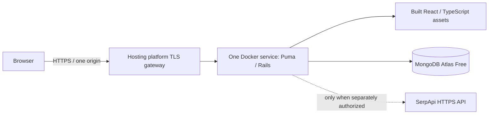

# Free hosting investigation and deployment guide

Investigated on **2026-10-12**. **No public application deployment or live URL
has been verified.** The source repository is public; hosting it is a separate
step. No paid resource, payment method, or paid SerpApi request was created.

## Proposed topology

The root `Dockerfile` builds React with Node and installs frozen production
Ruby dependencies in separate stages. The runtime contains Rails and built
static assets, running as UID 10001. It runs one Puma process; Node, a Vite
development server, and a second nginx process are not needed at runtime.
The six existing pages use hash navigation and same-origin `/api` requests,
so cookie sessions and CSRF do not require a cross-origin rewrite.

`SERVE_FRONTEND=true` enables the hosting policy for static and API responses:
CSP and security headers, API `no-store`, HTML `no-cache`, immutable successful
hashed assets, and bounded 16 KiB request bodies. Puma also limits incoming
bodies before Rails; its own rejection response is plain HTTP 413 rather than
the Rack JSON error. Existing separate frontend/backend Dockerfiles remain
available. No API routes, models, authentication, or search features were removed.

`PORT` is respected by Puma and the container health check. Render can supply
its exact assigned hostname through `RENDER_EXTERNAL_HOSTNAME` when
`ALLOWED_HOSTS` is absent. Explicit hostname configuration remains supported;
empty/invalid configuration does not become a wildcard. Set
`RAILS_ASSUME_SSL=true` only behind a trusted platform HTTPS gateway that keeps
the backend HTTP port private. Local/public plain HTTP exposure is not a valid
production substitute.

## Options and evidence

| Option | Observed evidence | Decision |
| --- | --- | --- |
| MongoDB Atlas Free, formerly M0 | Official source describes a non-expiring free cluster: MongoDB 8.0, 0.5 GB including indexes, 500 connections, 100 operations/second | Suitable database candidate for a small portfolio demo; account and TLS connection still needed |
| Render | Official examples use `plan: free` and generated secrets; official CLI supports Docker and remote Blueprint validation | Preferred application-host candidate, conditional on current dashboard confirming $0 Docker hosting and no unapproved overage/card requirements |
| Railway | Current official docs offer $1 monthly Free credit; persistent database connections can prevent sleep; the configurable spend-limit minimum is $10 | Ongoing zero-cost operation of this application is unproven; not selected |
| Fly.io | New accounts have no ongoing free compute; introductory trial is two VM-hours or seven days | Excluded as ongoing free hosting |
| Koyeb | Current pricing/card/capacity pages could not be reached from this cloud environment | Not treated as a verified free alternative |
| GitHub Pages / frontend-only hosting | Can serve static assets, but cannot run this Rails API and persistent MongoDB | Does not deploy the complete application |

The proxy rejected CONNECT requests to the providers' documentation domains
with HTTP 403 before reaching the origin. Official Atlas, Railway, and Fly
documentation source was readable on GitHub. Render's exact current free
RAM/CPU, hours, idle behavior, build/bandwidth allowances, card requirements,
and overage policy were **not verified**. Do not substitute remembered limits
or an introductory credit for a current no-charge contract.

Atlas Free has no managed backups or storage autoscaling, uses public network
access with an IP allowlist, and may pause after 30 days without connections.
It allows one free cluster per project and throttles beyond 10 GB inbound or
10 GB outbound over a rolling seven-day period. The free creation interface
shows eligible regions; official source lists AWS Oregon and Frankfurt as
eligible. These are published limits, not measured SearchScope usage.

Sources read:

- [Atlas Free limits](https://github.com/mongodb/docs/blob/9b94176c3d5ffc440fe634f974451ea6b1409153/content/atlas/source/reference/free-shared-limitations.txt)
- [Atlas free-cluster creation](https://github.com/mongodb/docs/blob/9b94176c3d5ffc440fe634f974451ea6b1409153/content/atlas/source/tutorial/deploy-free-tier-cluster.txt)
- [Atlas eligible AWS regions](https://github.com/mongodb/docs/blob/9b94176c3d5ffc440fe634f974451ea6b1409153/content/atlas/source/reference/amazon-aws.txt)
- [Render's official Blueprint example](https://github.com/render-examples/fastapi/blob/main/render.yaml)
- [Render generated-secret example](https://github.com/render-examples/django/blob/master/render.yaml)
- [Render CLI remote Blueprint validator](https://github.com/render-oss/cli/blob/2dcd548c15503e23f2d1fbcf2c9302d4a9303404/cmd/blueprintvalidate.go)
- [Railway Free pricing](https://github.com/railwayapp/docs/blob/e70fa22eb4f3a5fc991938f83d16c1573e145f53/content/docs/pricing/plans.md)
- [Railway spend limits](https://github.com/railwayapp/docs/blob/e70fa22eb4f3a5fc991938f83d16c1573e145f53/content/docs/pricing/cost-control.md)
- [Railway serverless caveats](https://github.com/railwayapp/docs/blob/e70fa22eb4f3a5fc991938f83d16c1573e145f53/content/docs/deployments/serverless.md)
- [Fly trial](https://github.com/superfly/docs/blob/0fc1a74ab5afa558c16b7c58613bbc0a5751faf4/about/free-trial.mdx)
- [Fly discontinued free plans](https://github.com/superfly/docs/blob/0fc1a74ab5afa558c16b7c58613bbc0a5751faf4/about/discontinued-plans.mdx)

## What blocks an autonomous deployment

The current Codex environment has GitHub repository access, but no authenticated
Render account/API binding or Atlas database connection. The existing GitHub
connection does not authorize a Render account. Provider billing must be
confirmed in the actual account before creating a public service.

Direct Render API/docs and Atlas control-plane domains are also blocked by
the current cloud proxy. This is distinct from a missing account credential.
No request was made to create a billable resource, and no live URL is invented.
Local Docker/YAML checks do not count as Render's authenticated Blueprint
validation or as a public browser test.

## Complete the free setup in Browser

1. **Browser — MongoDB Atlas:** sign in or create an account. Create a separate
   SearchScope project and select **Free / M0**, not Flex, dedicated, or a paid
   trial upgrade. Inspect the price and stop if the flow requires a charge or
   an unapproved payment method. Choose an eligible region near the app host.
2. **Browser — Atlas Database Access:** create a dedicated application database
   user with `readWrite` access to the `searchscope` database. Use a generated
   strong password. Do not grant organization, cluster, or all-database admin
   privileges. The app needs collection and index creation at startup.
3. **Browser — Render:** sign in and connect only the `searchscope` GitHub
   repository if requested. Confirm the current Free web-service plan and all
   build/bandwidth/overage rules. Stop if payment, a paid workspace, an upgrade,
   or uncontrolled billable overages are required. Do not add a payment method
   merely to continue. Existing cards/account settings must be reviewed too.
4. **Browser — Render:** create a Blueprint from this repository using
   [render.yaml](../render.yaml). It declares only one `plan: free` Docker web
   service. It creates no paid database, disk, cron job, worker, replica, or
   external API key. Ask Render to validate the Blueprint before applying it;
   local parsing has not proven provider acceptance.
5. **Browser — secure environment settings:** enter Atlas's application URI
   under `MONGODB_URI`, including the `searchscope` database and TLS/SRV settings.
   URL-encode any reserved password characters as required by the driver.
   Enter it only in the provider's secure form, never Git, chat, a screenshot,
   or frontend variables. `SECRET_KEY_BASE` is generated by the platform and
   must remain stable across deploys.
6. **Browser — Render service connection settings / Atlas Network Access:**
   obtain the service's documented outbound IP addresses/CIDRs and add only
   those to Atlas's IP access list. Avoid `0.0.0.0/0`. The service might initially
   fail its database startup until this rule is present; then retry deployment.
   Runtime connection strings and IP rules must be tested in that environment.
7. **Browser — Render:** confirm `SEARCH_PROVIDER=demo`, the allocated hostname,
   service readiness, and logs without exposing secrets. Leave `SERPAPI_API_KEY`
   unset. This runs all UI/persistence/comparison/analytics features with
   explicitly synthetic results and no provider-credit usage.

If you want Codex to operate the Render API, create a scoped key in the actual
account/API-key settings and bind `RENDER_API_KEY` securely in the Codex cloud
environment. Never send the key in chat. Add `api.render.com` to the environment
network allowlist, preserving existing entries, and provide the actual assigned
public hostname for browser checks. The Atlas URI can stay in Render's secure
settings. A key alone does not authorize charges or paid searches.

## Verification before adding a live URL

Once a real service is provisioned, **Browser / Codex** must verify:

- HTTPS without certificate warnings; `/`, hashed JS/CSS, and `/api/v1/health`
  return their expected types/statuses from the same assigned hostname.
- Session bootstrap, registration/login, Secure/HttpOnly/SameSite cookies,
  valid CSRF requests, and rejection of missing/foreign-origin CSRF requests.
- Demo Google/Bing searches persist in Atlas, history/detail/filter/pagination,
  comparison, account-specific analytics, monitoring database ping, and settings.
- Confirmed deletion updates actual metrics; logout/login works; no uncaught
  browser errors or secret-bearing output appears.
- Restart/redeploy preserves owned data in Atlas. Record actual health,
  browser, database, and CI outcomes, including cold starts or provider errors.

Only then add the verified HTTPS URL to README, the CV/email, and evidence
documents, labelled as a **demo using synthetic search results**. Do not add a
predicted `.onrender.com` hostname, claim production users, or infer AWS skills.
Paid SerpApi integration verification remains separately authorized.

Use fictional `example.test` email addresses and a unique test-only password
for the public demo. Account deletion/password reset/email verification and
managed backups are not implemented; avoid sensitive queries or real personal
information. Do not use keepalive jobs to defeat a provider's free-tier sleep
policy or host this app indefinitely on GitHub Actions runners.
